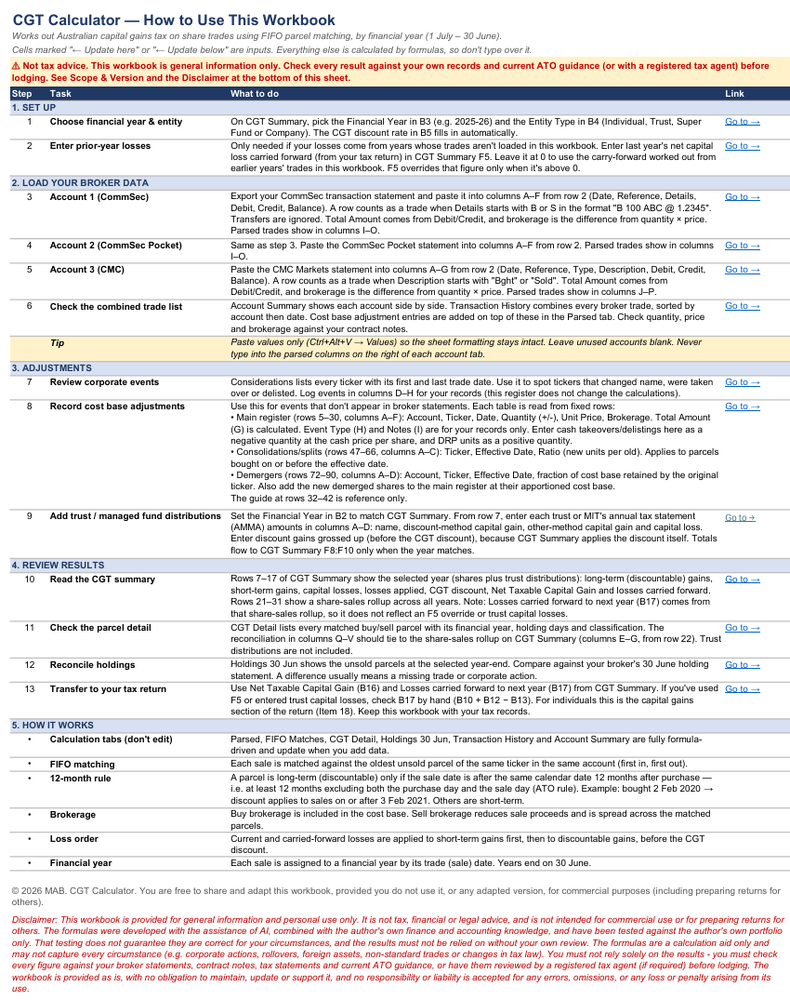
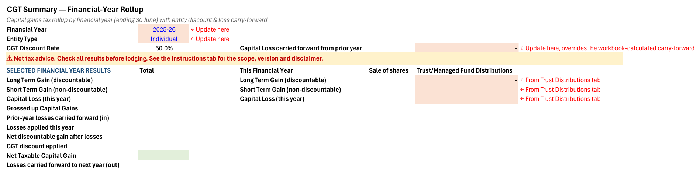

# CGT Calculator for Australian Shares (Excel)

> ⚠️ **Not tax advice.** This workbook is a calculation aid for general information and personal use only. Check every result against your broker statements and current ATO guidance, or with a registered tax agent, before lodging.

> 💻 **Requires Microsoft 365 or Excel 2024.** It uses newer Excel functions (dynamic arrays, LET, LAMBDA, VSTACK) and **will not work** in Excel 2021 or earlier, Google Sheets, Numbers or LibreOffice.

A free Excel workbook that works out Australian capital gains tax on ASX share and ETF trades, by financial year, from your broker transaction statements.

It is a plain **`.xlsx` file with no macros or VBA**, so nothing runs when you open it. Every result is an ordinary Excel formula you can click into and check.

## Download

**[⬇️ Download CGT.xlsx](CGT.xlsx)**, or open the file in this repository and click **Download raw file**.

## Features

- **Broker import:** paste transaction statements (csv format) from **CommSec**, **CommSec Pocket** and **CMC Markets**, in any combination (leave unused accounts blank)
- **FIFO parcel matching:** each sale is matched to the oldest unsold parcel of the same ticker in the same account
- **12-month discount rule:** a parcel is long-term only if held at least 12 months, excluding the purchase and sale days, per the ATO
- **Entity types:** Individual (50%), Trust (50%), Super Fund (33⅓%), Company (nil)
- **Capital losses:** current-year and carried-forward losses are applied to short-term gains first, then discountable gains, before the discount
- **Brokerage:** included in the cost base on buys and deducted from proceeds on sales
- **Trust / managed fund distributions:** enter capital gain amounts from your annual tax statements (AMMA)
- **Cost base adjustments:** record takeovers, mergers, demergers, splits and consolidations, buybacks and returns of capital
- **Holdings as at 30 June:** unsold parcels at year-end, to reconcile against your broker's holding statement
- **Audit trail:** a parcel-by-parcel detail tab with a reconciliation back to the summary
- **Protected formulas:** formula cells are locked to prevent accidental changes, input cells stay editable, and you can unprotect without a password

## Screenshots

| Instructions | CGT Summary |
|---|---|
|  |  |

## How to use

1. **Load broker data:** export your transaction statements (csv format, better to select from the earliest financial year so that it can pick up the correct cost base of the purchases) and paste them, as values only into the account tabs:
   - **Account 1 (CommSec)** and **Account 2 (CommSec Pocket)**: from row 2, columns A–F (Date, Reference, Details, Debit, Credit, Balance)
   - **Account 3 (CMC)**: from row 2, columns A–G (Date, Reference, Type, Description, Debit, Credit, Balance)
2. **Set up:** on the **CGT Summary** tab, choose the Financial Year and Entity Type.
3. **Adjustments:** record any corporate actions on **Cost Base Adjustments**, and trust distributions on **Trust Distributions**.
4. **Review:** check **CGT Summary**, **CGT Detail** and **Holdings 30 Jun**.
5. **Transfer:** use *Net Taxable Capital Gain* and *Losses carried forward to next year* in your tax return.

Full step-by-step instructions are on the **Instructions** tab inside the workbook.

## Scope and limitations

- **Tested** against the author's own trades for the **2021-22 to 2025-26** financial years only
- **For** Australian resident taxpayers holding ASX-listed shares and ETFs
- **Not covered:** foreign residents, foreign-listed assets or currency, options, warrants, CFDs, crypto, employee share schemes, pre-CGT assets, cost base indexation, small business concessions and inherited assets
- **Corporate actions** are only included if you record them yourself
- **FIFO** is used for convenience. If your records identify the specific parcels you sold, the ATO allows you to use those instead, and your results may differ
- **Broker formats:** parsing relies on each broker's export layout as at the version date and may break if a broker changes its format
- **Tax law changes:** rules and rates can change after the version date. Check current ATO guidance for each year you use it

## Reporting issues

Found a bug or a broker format that doesn't parse? Please open an [Issue](../../issues) and include:
- your Excel version
- which tab and cell looks wrong
- an **anonymised** example of the statement row (remove account numbers, names and anything else personal)

I can't provide personal tax advice. For questions about your own situation, please contact the ATO or a registered tax agent.

## Version history

| Version | Date | Notes |
|---|---|---|
| 1.0 | October 2026 | Initial release |

## Licence

© 2026 MAB. CGT Calculator. You are free to share and adapt this workbook, provided you do not use it, or any adapted version, for commercial purposes (including preparing returns for others).

## Disclaimer

This workbook is provided for general information and personal use only. It is not tax, financial or legal advice. The formulas were developed with the assistance of AI, combined with the author's own finance and accounting knowledge, and have been tested against the author's own portfolio only. Results must not be relied on without your own review against your broker statements, contract notes, tax statements and current ATO guidance, or a review by a registered tax agent. The workbook is provided **as is**, without warranty of any kind, with no obligation to maintain, update or support it, and no responsibility or liability is accepted for any errors, omissions, or any loss or penalty arising from its use.

This is an independent, unofficial tool. It is not affiliated with, endorsed by or sponsored by any party. Their names are used only to identify the statement formats the workbook reads, and all trademarks belong to their owners.
